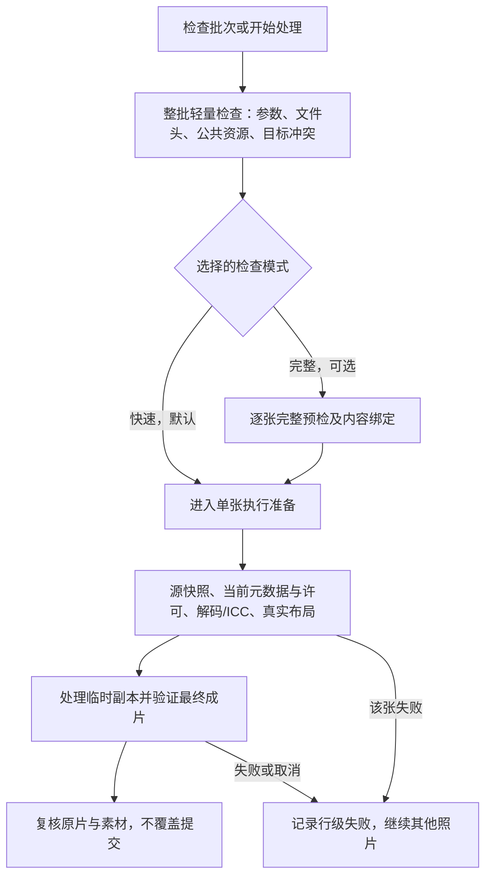

# 处理速度提升计划：优先缩短预检等待

更新时间：2026-10-26。方案核对基线：`b10f463b9afc3a5eef44014a0d9ec8e7fda669b8`，分支 `codex/performance-check-processing`。

本计划根据“当前预检太慢，可以省去不必要预检”的要求于 2026-10-25 重写，用户随后授权实施，并特别要求继续优化 NEF 校验、按节点提交推送。**默认改为快速预检：整批只做轻量检查，照片的完整解码、ICC 转换和实际水印渲染放到单张处理时完成。** 完整预检保留为可选模式；最终输出检查继续执行。2026-10-26 的代码、回归和性能证据持续记录在[实施记录](performance-implementation.md)，本文件保留取舍、依赖和验收定义。

本计划取代旧计划中“首次必须完整解码整批照片”的限制，以及以完整预检缓存为主要提速手段的优先级。I0–I8 已有实现继续作为基础，证据见[实施记录](performance-implementation.md)；新节点统一编号 Q0–Q5，概览同步到[总计划第 19 节](plan.md#19-性能调研成果改进计划2026-10-15)。

## 1. 当前慢在哪里

当前 `build_plan()` 会对整批逐张执行 `Step.validate()`，全部通过才启动处理。JPEG 水印预检会完整解码、建立 ICC 变换、实际渲染水印区域、检查数字容量、读取日期/GPS，并在 GUI 检查缓存路径读取原片强摘要。处理阶段 `prepare_jpeg()` 又会解码并执行方向和色彩转换，再实际渲染水印。因此，**完整预检解码是可以取消的一次额外工作**；处理阶段的解码本来就必须进行。

2026-10-25 在当前代码上运行既有 GUI 基准：Linux，3 张 5038×3363 合成 JPEG，每张约 39.2 MiB，嵌入 sRGB，数字水印关闭，每个入口 3 轮。手动检查中位数 **1.780 秒**（1.770–1.900 秒），其中 `validate_jpeg()` 累计中位数 **1.362 秒**，约为检查等待的 77%；ICC 建立约 0.022 秒，局部试渲染约 0.013 秒。完整记录、限制和复现命令见[调研第 9 节](performance-research.md#9-2026-10-25-重写预检提速方案的证据)。

这组历史数据支持先删除预检阶段的整图解码；不支持把 ICC 缓存、字体微调或更多线程作为首要任务。约 77% 是旧版本阶段占比，**不是优化后的加速比例**；正式新旧配对结果单独记录，不以阶段占比替代收益。

已经完成的工作不重复列为待办：最终数字签名核验合并、RGB/方向副本优化、128 行亮度条带、同边界重复摘要合并、当前照片预览缓存、按内存准入最多双任务、NEF 完整基线复用。ICC/槽位缓存与稀疏 FFT 已经筛选暂缓。

## 2. 哪些预检省去，哪些保留

“省去”分为三种：重复工作直接取消；有必要但无需阻塞整批的工作延后；同一批次的共同检查合并一次。表中为设计责任划分，当前实现状态见实施记录。

| 检查项 | 默认快速预检 | 单张处理与最终责任点 |
| --- | --- | --- |
| 工作流顺序、组件版本、参数类型及取值范围 | 保留；相同 `StepSpec` 每批校验一次 | 执行使用冻结的参数；基础 API 仍校验自身输入 |
| 勾选项、源文件存在、输入格式、输出目录、重名及目标已存在 | 保留轻量检查；所有目标的冲突扫描在任何提交前完成 | 单张开始复查路径；提交仍使用 `commit_no_overwrite()` 抵御后续占用 |
| 参与水印的 JPEG 格式、宽高、60 MP 上限、EXIF 方向值、明显不支持的模式 | 保留头部检查；不调用 `load()`、`convert()`、`exif_transpose()` 或数组转换 | 执行重新核对实际格式、尺寸与内存预算，再解码；方向只实际应用一次 |
| JPEG 全像素解码、扫描损坏/截断数据 | **从默认预检删除** | `prepare_jpeg()` 实际解码时拒绝坏图，该张失败且不提交 |
| 每张 ICC profile 解析与 `buildTransform()` 可转换性试验 | **从默认预检删除** | `prepare_jpeg()` 的实际色彩转换负责拒绝坏 ICC；无 ICC 歧义模式仍拒绝 |
| 每张 `render_watermark_region()` 试渲染 | **取消预检试渲染**，保留参数及公共资源基础检查 | 实际渲染检查字形、尺寸、边界；失败不得保存成成功结果 |
| 每张读取字体/签名、重复资源摘要与相同字形扫描 | **合并为每批实际使用资源一次**；拉丁/中文 face 分别处理，中文字体仅在用到时检查 | 执行仍绑定资源内容并检查变更；不能只凭路径/mtime 信任缓存 |
| 数字签名容量检查 | 数字水印关闭则完全跳过；开启时用头部尺寸和一次解析的签名 payload 做轻量容量计算 | 嵌入前重新核对真实尺寸；最终完整提取一次，不能用容量检查代替提取 |
| 全批原片 SHA-256，以及为命中完整预检缓存而重复读取原片 | **快速模式不做这些全文件扫描，也不复用“已完整验证”的旧结论** | 每张开始时建立强内容快照，绑定此次元数据/像素；结束复核源文件和当前产物 |
| 日期、GPS、辅助 GPS 的预检 ExifTool 请求 | 已有界面数据用于提示；新读取延后到该张执行准备，按启用功能合并所需标签 | 手工/表格日期保留；EXIF 来源必须从当前文件重新解析，不能把旧界面值变成权威数据 |
| 手工日期、坐标/海拔、类别/文字、JPEG 质量与采样参数 | 保留内存内校验，不因这些廉价检查而全读原片 | 必需字段仍必需；EXIF 日期暂未确认时标记“处理时确认”，不能伪造日期 |
| 辅助 GPS 清除检查 | 已明确允许清除时可省去单独的“是否存在”预读；未允许时延后至该张写入前检查 | **必须先检查再调用 `write_gps()`**；现函数会清空 GPS，不能删掉唯一的许可判断 |
| NEF RAW/预览/元数据/诊断完整指纹 | JPEG 首期不动；NEF 专项改为该张执行前建立完整基线 | 写后完整指纹比较、GPS 读回、源文件复核全部保留；这里只减少整批启动等待 |
| 写后 GPS、白名单元数据、方向/尺寸/ICC、旧预览排除、数字签名完整恢复 | 不属于可删预检项 | 沿用现有提交前检查；数字水印关闭时不新增签名核验 |

头部检查仍可能读取较大的 EXIF/ICC 段，不能承诺固定几毫秒或完全零 I/O。项目已有签名 payload、字体和缩放签名缓存；本计划是减少按照片重复调用和扫描，不是再次引入同名缓存。尺寸/方向和数字容量是廉价且有用的检查，不为追求“零检查”删除它们。

各项只针对实际启用的组件：仅坐标流程不要求水印日期、字体、签名或 60 MP 水印上限；仅水印流程不要求填写新坐标。关闭数字水印只跳过频域 payload/容量检查，可见签名素材仍要使用和验证。

## 3. 调整后的执行契约

### 3.1 先解除执行对“完整预检产物”的依赖

当前 `WatermarkStep.execute()` 必须找到 `_PreparedWatermark`，其中包含配置、日期来源、尺寸、资源摘要和源状态；`working_memory_bytes()` 也依赖它。直接删除 `validate()` 或只删其中几行会造成执行拒绝、旧配置复用或内存预算失效。

实施时拆为“轻量计划”和“单张执行准备”。轻量计划保存用户选择、参数、输出目标、检查模式、头部尺寸与资源引用；执行准备从当前输入构造完整的单张上下文，供后续步骤使用。全局参数验证从照片循环中移出；各照片仍保留必要的类型兼容、字段和目标检查。

### 3.2 快速预检不再冻结整批照片字节

快速检查表示“可以开始处理”，不表示整批文件已经完整解码或内容永久未变。单张开始时重新读取当前文件头、必需元数据，建立强摘要及文件身份约束；用户手工/表格输入随作业固定，EXIF 来源随本次源文件解析。检查后同大小、同 mtime 替换的文件也必须重新解析，不能拿旧日期、尺寸、GPS或缓存通过结论套用。

单张起止快照须覆盖整个步骤链。组合流程中，最初源文件的约束要穿过坐标步骤和水印步骤，不能在两个步骤之间重新接受另一份原片。GPS 写入后的临时副本是水印元数据权威来源，写前原片记录不能覆盖它。处理中源文件或素材变化，丢弃该张临时产物，不提交。

完整模式保持原有内容绑定：检查到执行之间内容变化则拒绝或重新完整检查。快速与完整计划、缓存必须显式区分，不能让快速检查记录伪装成完整检查通过。已有 `WatermarkPreflightCache` 优先留给完整模式；默认快速模式不应为了命中该缓存，再读两遍整张原片。

### 3.3 延后检查必须有实际负责者

- JPEG：`prepare_jpeg()` 已负责真实解码、方向规范化和 ICC 转换，`render_watermark_region()` 已负责真实布局与字形；把它们接入执行准备及行级错误处理，无需先试做一次。
- 仅水印：`preserve_watermark_metadata()` 已拒绝不完整 GPS；可在单张准备的联合元数据读取中提前发现，避免先编码再失败。最终独立读回保留。
- 坐标＋水印：若要求沿用“原片不完整 GPS 拒绝”语义，应在该张写坐标前检查原片。只检查写好坐标的副本会掩盖原片问题，是额外行为变化，不能当作单纯延后检查。
- 辅助 GPS：当前 `LocationStep.execute()` 没有执行前许可判断；迁移该检查是删预检请求的前置条件。清除选项关闭时，不得绕过；选项开启也仍须保留写后读回与现有报告规则。
- NEF：现有无缓存分支会执行前计算指纹，但不能直接照搬来替代 I7 的完整绑定；必须保留前后文件状态一致性，并把完整基线关联到同一源内容。
- 公共素材：每批验证一次资源与所需字符；未解析的 EXIF 日期可能增加字符，最终渲染仍检查。首期保留逐项执行边界的资源摘要，后续只有在共享不可变字节快照实现并验证后才合并这些摘要。

### 3.4 保持双任务的内存准入

快速计划从 JPEG 头部获取像素数，继续使用当前保守预算 `像素数 × 24 B + 128 MiB/项`，最多双任务；未知预算、NEF 或内存不足仍串行。执行重新读到的尺寸若与准入时不一致，**在解码前拒绝该张并要求重新规划**，避免两张照片同时变大造成预算越界。不能因为 `_prepared` 延后创建而默默失去准入检查。

## 4. 用户可见行为

| 场景 | 快速检查，计划默认 | 完整检查，可选 |
| --- | --- | --- |
| 点击“检查批次” | 返回“基本检查通过，文件完整性将在处理时检查” | 完成全批像素/ICC/布局等检查后报告结果 |
| 直接点击“开始处理” | 完成轻量检查后开始逐张执行，不先完整读完所有照片 | 执行完整检查后再开始 |
| 检查后再次开始 | 重建目标与动态轻量信息；不重复全批解码或扫描原片摘要 | 内容绑定未失效可按现有完整缓存规则复用 |
| 第 20 张才是截断图 | 前 19 张可能已成功提交；第 20 张失败，其余按现有失败隔离继续 | 若预检发现，则处理开始前阻止批次 |
| 检查后原图被替换 | 不信任旧 EXIF/布局，按当前内容准备；尺寸等影响准入时拒绝并要求重规划 | 内容不符则拒绝或重做完整检查 |

这是有意改变错误发现时机，并接受部分成功结果；不是保证整批原子成功。两种模式的最终输出质量、文件安全检查相同。模式选择应在同一处明确表达并随计划保存，开始按钮不能暗中切换模式。取消时停止新任务，清理未提交产物；已成功提交的文件保留，重试沿用现有不覆盖规则。

## 5. 按依赖推进的执行清单

以下表格定义节点的依赖与验收；当前进度见实施记录。旧 I0–I8 不重新开发，旧 I9 的 Windows 交付验证由 Q5 汇总新结果后衔接。用户明确要求先提供本地新编译 EXE，收到 Windows 测试通过确认后才能发布；此前不合并 main、不建标签/Release、不触发正式发行构建。

| 节点 | 优先级与依赖 | 具体交付及涉及位置 | 验收与退路 |
| --- | --- | --- | --- |
| Q0 测量口径补齐 | P0；先做 | `benchmark_pipeline.py`、`benchmark_metrics.py`：分别记录手动检查、开始后的自动检查、首项执行准备、首张提交、整批完成；补 `file_state` 的次数/字节量/时间，区分素材与原片；记录实际并发数 | 不能把 GUI 的 `preflight_seconds=0` 当作没有自动预检；先得到同基线可复现报告，再动业务路径 |
| Q1 JPEG 快速预检 | P0；Q0 后，主收益项 | `engine.py`、`steps.py`、`images.py`：拆轻量计划/单张准备；头部尺寸替代完整预检解码，取消 ICC 试验和预检试渲染；迁移配置生成、日期/GPS及源快照绑定；保持内存准入 | 快速预检每张完整解码和 ICC 建立均为 0；单张实际处理依然拒绝坏图/ICC/布局；当前正确输入的像素、元数据和数字签名结果一致；新契约未闭合时不接默认入口 |
| Q2 GUI 与重复预检整理 | P0；Q1 后 | `workers.py`、`main_window.py`、表格快照及日期来源逻辑：默认快速、完整可选；强摘要缓存只服务完整模式；公共资源/参数按批合并，数字关闭不读 payload，不用中文不读中文字体 | 检查→开始不再次完整预检；明确手工/表格/EXIF 来源；读取中、缺失和无效状态准确；辅助 GPS 许可关闭时仍拒绝；目标冲突始终有效 |
| Q3 NEF 延后完整基线 | P1；Q1/Q2 稳定后独立实施 | `LocationStep`、`nef_gps.py`：默认整批预检不提取每张 RAW/所有预览，进入该张执行时完成绑定基线；取消/结束及时释放 | 授权真实 NEF 验证；完整写前/写后指纹次数不因迁移而增加；区分首项开始改善与总吞吐；未通过则 NEF 保持完整预检，不拖延 JPEG 交付 |
| Q4 处理阶段重复读取 | P2；Q0 证明仍是热点才做 | 在同一文件内容和标签覆盖范围内复用日期/GPS/白名单读取；只读资源字节快照按成本另测；不跨坐标写入复用旧权威元数据 | 配对结果超过波动才保留；保留写后独立读回；已存在的常驻 ExifTool、同路径摘要合并不重复开发；收益小则暂缓 |
| Q5 合并验收与交付记录 | Q1/Q2 和本期纳入的 Q3/Q4 完成 | 正确性矩阵、至少五轮配对、真实 JPEG/NEF、原生 Windows 及候选 EXE 检查；更新实施记录 | 报告预检、首张、整批、内存和取消；不把延后工作算作已省去。Windows EXE 和发布仍按既有用户验收要求另行推进 |

顺序：**Q0 → Q1 → Q2 → Q5** 是 JPEG 主线；Q3 是 NEF 独立增量，Q4 是有证据才进入的处理优化。每项分别验证再进入下一项，不先进行全项目重构。先不增加线程数，不换图像引擎、不引入新依赖。

## 6. 验收指标和故障矩阵

### 6.1 测量目标

| 指标 | 验收目标；实际成绩见实施记录 |
| --- | --- |
| JPEG 快速预检 | 当前 3 张 17 MP 固定样本较旧完整预检中位数下降至少 60%；20 张以上另测增长曲线，证明不再随像素完整解码/原片全字节扫描增长 |
| 点击开始到首项实际准备、首张提交 | 都必须单独记录并改善，首项准备不能只记录 UI 状态切换；大批次开始前只剩必要的轻量 O(N) 扫描 |
| 检查后开始的累计等待 | 包括两次点击后的实际等待；重复快速检查不触发全批源摘要或完整解码 |
| 整批端到端时间 | 与同入口、同参数、同并发策略的旧版交替至少 5 轮；超过 `max(5%, 基线自身波动)` 的回退必须修正或解释后重新评估，不用预检减少掩盖总耗时增加 |
| 调用次数 | JPEG 快速预检：完整源摘要 0、完整解码 0、ICC 建立 0、实际水印渲染 0；保留头部读取、公共资源与轻量容量检查；执行/最终检查次数另报 |
| 峰值与取消 | 不缓存整批像素；记录同时进程树 RSS、Windows 工作集/私有字节；保留内存准入。记录取消到退出实际耗时及最慢不可中断阶段，不只验证 UI 可点 |

至少覆盖 1/3/20/100 张，约 12/17/24/45 MP，60 MP 上限及超限；关闭数字水印、DCT、FFT 分开；仅坐标、仅水印、组合、NEF 分开。大批次先用于轻量检查及调度评估，不必把全部尺寸做笛卡尔积。使用不同内容的独立文件补测，硬链接合成样本不能代表大量真实照片或物理冷盘。网络盘/移动硬盘如是实际场景，分别记录；不以热缓存结果推断。

### 6.2 必须覆盖的行为

- 好图/坏图/好图：快速模式按行失败且继续；完整模式在执行前发现。截断 JPEG、坏 ICC、无 ICC CMYK、Orientation 1–8、60 MP/超限分别检查。
- 缺少手工日期、无 EXIF 日期、`allow_create_date` 开关、表格日期来源、检查后替换原片日期，确保来源和实际水印一致；不默默沿用导入缓存。
- 字体/签名缺失、TTC face、缺字、透明或无笔画签名、布局越界、数字容量不足；数字关闭时跳过相关检查，中文资源不被无关任务强制要求。
- 同大小同 mtime 内容替换、处理前尺寸变大、单项处理中原片/素材变化；组合流程两步骤之间变更；完整缓存失效与快速模式重新准备分别断言。
- 辅助 GPS 清除选项开/关、源 GPS 不完整、仅水印保留 GPS、组合流程采用已定位副本、海拔和 NEF GPS 时间规则；防止移动预检时漏掉唯一检查。
- 目标重复/已存在/预检后被占用、取消/关闭/重试、双任务内存准入、单张失败后的结果顺序；失败产物不提交，原片不变。
- 元数据传递后损坏、最终数字签名不一致、NEF RAW/预览/非 GPS 元数据差异仍失败；独立 `export_watermark_preview()` 继续自校验。

以上为实施时的测试要求。已经新增/扩展 workflow、images、元数据、NEF、频域和 GUI 回归，具体通过数及未验证平台单独记录，避免只断言“少调用一个函数”而漏掉错误处理行为。

## 7. 依据及本轮边界

| 源码位置（基线 `b10f463`） | 支持的结论 |
| --- | --- |
| `src/aim_tool/workflow/engine.py:113`、`:173` | 全批 validate 后才能执行；逐项失败隔离与当前源 stat 约束，快速模式须调整契约 |
| `src/aim_tool/services/images.py:33`、`:59`、`:96` | 完整预检解码；执行再次解码/转换/渲染，是主要可省重复工作 |
| `src/aim_tool/workflow/steps.py:384`、`:446`、`:454` | 缓存/元数据/素材/尺寸准备，与执行和内存准入的依赖 |
| `src/aim_tool/workflow/steps.py:77`、`:126` | NEF 全指纹及辅助 GPS 检查目前位于预检；执行无缓存路径已有部分基础能力 |
| `src/aim_tool/services/exiftool.py:532`、`:550` | 辅助 GPS 标签判定、写入清除 GPS 与写后读回；许可判断不能直接丢弃 |
| `src/aim_tool/services/metadata.py:67` | 元数据白名单与 GPS、方向、ICC/尺寸、旧预览最终检查 |
| `src/aim_tool/services/file_state.py:17`、`src/aim_tool/services/output.py:49` | 强内容快照为全文件读取；目标提交不覆盖已有文件 |
| `src/aim_tool/ui/main_window.py:735`、`scripts/benchmark_pipeline.py:41` | 两个按钮均进入预检；现有 GUI 计时字段不能直接当纯执行时间 |

[Pillow 官方 Image 文档](https://pillow.readthedocs.io/en/stable/reference/Image.html#PIL.Image.open)明确 `Image.open()` 是延迟像素读取；因此可读取头部尺寸而不完整解码。[ImageOps 官方实现](https://pillow.readthedocs.io/en/stable/_modules/PIL/ImageOps.html#exif_transpose)中的方向处理会加载像素，不能拿来做轻量预检。官网 stable 当前为 13.0.0，本机 12.3.0 的对应实现已单独核对；本计划不要求升级 Pillow。

2026-10-25 文档阶段曾用临时合成文件复核：正常 JPEG 可准备；截断 JPEG、坏 ICC、无 ICC CMYK 能打开头部，但 `validate_jpeg()` 与实际 `prepare_jpeg()` 都会拒绝。原始诊断保存在忽略目录 `build/performance/research-20261025/`。2026-10-26 的实现还加入了真实工作流回归和新旧配对；原始性能报告继续留在本地忽略目录，私人样片不随代码或测试 EXE 分发。
