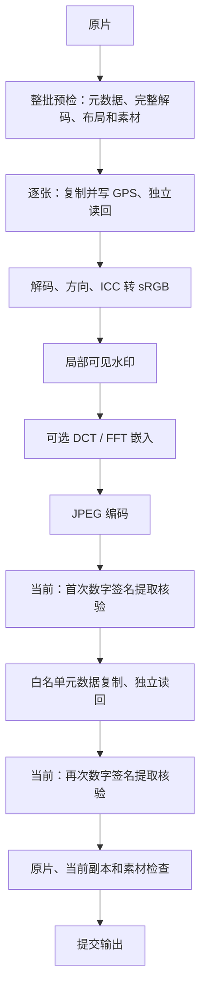

# 当前架构下的进一步提速调研

调研日期：2026-10-15。源码基准：`1b510b11895912c59a36aa238da468219f59000c`（本地 `main`）。范围是主页面的 JPEG 坐标、水印、组合流程，以及 NEF 坐标流程；本次仅形成调研和隔离原型实验记录，未修改应用源码或启用正式优化。

计划状态更新（2026-10-18）：调研成果已统一列入 [改进计划第 19 节](plan.md#19-性能调研成果改进计划2026-10-15)，新增检查侧 I4a 和分阶段交付条件。第 1–7 节保留 2026-10-15 的历史证据；[第 8 节](#8-2026-10-18-复核检查速度与处理速度)为本次源码复核和补测。后续实施顺序、条件实验和暂缓项以计划为准，应用代码尚未修改。

## 1. 结论与推荐顺序

目前仍有提速空间，优先方向是**减少重复计算和整图内存搬运，再引入按内存预算控制的并行**。现有 Python/PySide6 架构可以继续使用。Pillow 和 NumPy 已承担大量原生计算，暂没有证据支持整体改写 C++、上 GPU 或更换整套图像引擎。

建议依次推进：

1. 补全当前版本分阶段基准，覆盖数字水印开关、DCT/FFT、NEF 和 Windows 成品环境。
2. 数字水印仅在最终元数据写入后完整提取核验一次；该项已列入执行计划，尚未实施。
3. 减少图像副本、频域中间数组，以及同一事务内的重复文件摘要计算；ICC 变换缓存根据第 7 节新证据下调为后续候选。
4. 合并同一文件状态的元数据读取；优化预览的解码/色彩底图复用。
5. 在单任务峰值内存降低后，验证最多两个任务的并行与独立 ExifTool 会话。
6. 只有剩余热点明确时，再试专用本地内核、SciPy FFT 或 libvips。

上述是实施优先级；除下文单独标注的局部原型实验外，其余方案尚无本项目的 A/B 收益数据。各方案的收益不能相加，需要每个阶段独立测量。

## 2. 现有架构和已完成的优化

源码核对入口：

| 部分 | 当前实现 | 对下一轮优化的约束 |
| --- | --- | --- |
| 批次 | `workflow/engine.py` 的 `build_plan` / `run_plan` | 整批预检完成后逐张串行执行；单张事务与失败隔离 |
| 后台线程 | `ui/workers.py` 的 `PreflightWorker` / `BatchWorker` | 放到 QThread 可避免阻塞 UI，但批次内部仍是串行 |
| 外部元数据工具 | `services/exiftool.py` | 已有 `-stay_open`；同一实例通过 `_session_lock` 串行处理请求 |
| JPEG | `services/images.py` | 预检完整解码；执行重新解码、规范方向、转换 sRGB、编码 JPEG |
| 可见水印 | `services/watermark.py`、`fonts.py` | 已用局部 RGBA 合成、字体和签名缓存；RGB 底图原地贴回 |
| 数字水印 | `services/frequency_watermark.py` | 已实现 DCT/FFT、分块取消和签名位图缓存；GUI 水印默认配置启用 DCT 中档 |
| 元数据保留 | `services/metadata.py` | 白名单读取→复制与覆盖标签→独立读回；组合流程以已定位副本为元数据来源 |
| NEF | `services/nef_gps.py`、`LocationStep` | 不显影；检查 RAW 数据、预览、非 GPS 元数据、诊断与 GPS 读回 |
| 提交 | `services/output.py` | 临时文件位于目标卷；最终通过硬链接方式提交，不覆盖已有目标 |

JPEG 组合流程可概括为：



图中两次数字核验仅在启用数字水印时发生。关闭数字水印时直接经过元数据流程。

### 历史性能数据的适用范围

[上一轮验收](performance.md)记录：3 张合成 5038×3363 JPEG，组合流程处理从 10.553 秒降到 6.281 秒；双线程原型约 4.338 秒，但主进程峰值内存从约 281 MiB 升到 479 MiB。该实验早于当前数字水印接入，不能用来预测现在 DCT/FFT 的吞吐量和并行峰值。

当前 `scripts/benchmark_pipeline.py` 使用空参数 `preset()`，没有经过 GUI 的 `digital_defaults()`，所以默认**不启用数字水印**。它也在预检和执行之间复用同一个 ExifTool 会话；GUI 的 `PreflightWorker` 退出时关闭会话，`BatchWorker` 执行时会重新开启。因此现有脚本不等价于包含 UI 等待、会话重启和预览的端到端耗时。

## 3. 本次实测及其边界

在 Intel N95（4 核）Linux 本机上，复用现有基准的数据生成与真实 ExifTool，补测 JPEG「坐标＋水印」；每批 3 张 5038×3363（约 16.94 MP），3 轮新进程，取中位数。三种模式使用相同透明折线签名、合成字体、sRGB、JPEG 质量 95 / 4:4:4，数字水印采用中档。每张输入约 39.2 MiB，属于高细节合成噪声，不代表常见照片压缩率。

| 数字水印 | 预检中位数（秒 / 批） | 处理中位数（秒 / 批） | 处理范围（秒 / 批） | 主进程峰值中位数（MiB） |
| --- | --- | --- | --- | --- |
| 关闭 | 1.545 | 5.729 | 5.586–5.863 | 280.8 |
| DCT 中档 | 1.535 | 13.027 | 12.983–13.753 | 590.7 |
| FFT 中档 | 1.542 | 13.273 | 12.761–13.348 | 591.8 |

27 张处理全部成功。模式间差值说明数字路径需要单独优化，但当前样本不能证明 DCT 一定比 FFT 快；两者的轮次范围有重叠。磁盘缓存未清空，三张来源是同一生成文件的硬链接，故这些结果不代表独立照片的物理冷盘读取。RSS 不含 ExifTool 子进程，包含生成素材及预检等生命周期；不是某阶段的瞬时峰值。未在 Windows、真实相机 JPEG 或 NEF 上复测。

另为每种模式各跑一次计时包装，得到以下**包含子调用**的诊断数据；不是上表三轮中位数，存在轻量计时开销，不可相加：

| 调用 / 范围 | 关闭 | DCT | FFT |
| --- | --- | --- | --- |
| 执行总计（秒） | 5.767 | 13.289 | 13.254 |
| `prepare_jpeg`，3 次（秒） | 3.084 | 3.065 | 3.121 |
| `embed`，3 次（秒） | — | 2.523 | 2.572 |
| `verify_signature`，6 次（秒） | — | 4.853 | 4.696 |
| 其中 `extract`，6 次（秒） | — | 1.733 | 1.569 |
| `luminance`，嵌入及提取共 9 次（秒） | — | 1.702 | 1.666 |
| DCT 投影 / FFT 变换内核合计（秒） | — | 0.928 | 0.882 |
| ExifTool 请求，执行阶段 15 次（秒） | 0.933 | 0.940 | 0.952 |

这支持先处理完整提取中的重复解码和整图数组：DCT 的 6 次核验共约 4.85 秒，而其中提取约 1.73 秒；差额还包含 JPEG 打开/解码、RGB 生成与签名检查，不能全归为频域计算。`prepare_jpeg` 的约 3.1 秒也混合了解码、方向及 ICC，尚不能据此承诺 ICC 缓存的具体百分比。槽位分配合计约 0.03–0.05 秒，当前样本不应把它排在重复核验之前；较大的真实字体也可能改变资源扫描成本。

### R1 局部原型 A/B：保留最终核验、跳过首次核验

另以 DCT 中档做 3 轮配对实验，每轮每个版本各处理 3 张，轮次交替先后顺序，均在新子进程运行，输入与参数同上。候选仅在实验进程中跳过 `export_watermark_preview()` 内的首次核验，返回后恢复真实核验函数；元数据复制后的最终完整提取仍执行。没有改动仓库应用源码。

| 版本 | 处理中位数（秒 / 3 张） | 结果 |
| --- | --- | --- |
| 当前双次核验 | 13.147 | 9 张成功 |
| 原型：仅最终核验 | 10.774 | 9 张成功 |

本机合成样本处理耗时减少 **18.0%**，约节省 2.37 秒/批；两者主进程峰值中位数均约 591 MiB，未见峰值内存改善，仍需要 R3。此百分比来自这组配对实验，不能用上方另一组基准的 13.027 秒代入。它不是 Windows/真实照片收益，也未覆盖独立导出、损坏注入、取消和完整回归，不能据此直接开启正式优化。实验用的临时函数替换仅用于隔离成本，正式实现需要明确的内部接口与默认保护。

额外一次计时运行确认：3 张成功输出对应 3 次 `verify_signature()` 和 3 次 `extract()`，而非原流程的各 6 次；该探针只在内部导出调用期间跳过早期核验，返回后即恢复，因此计数对应元数据完成后的最终关口。此处不将隔离原型视为生产实现。

环境探测另确认：本机 Python 3.12.3、Pillow 12.3.0、NumPy 2.5.3；Pillow 的 `libjpeg_turbo` 为 True，版本为 3.1.4.1。这只证明本地开发环境，不证明 Windows 冻结包使用完全相同的底层构建。[Pillow 官方特性检测](https://pillow.readthedocs.io/en/stable/reference/features.html#features)可用于在冻结自检中核对。

## 4. 优化方案评估

| 编号 / 顺序 | 方案 | 主要受益路径 | 收益判断 | 成本 / 主要风险 |
| --- | --- | --- | --- | --- |
| R0 / 必须先做 | 分阶段与进程树基准 | 全部 | 避免选错热点 | 小；需要覆盖真实 Windows 与存储设备 |
| R1 / 第一批 | 最终文件只做一次数字签名提取 | DCT、FFT | 可去掉一次完整解码和提取；可测性最强 | 小至中；独立导出 API 仍需自己核验 |
| R2 / 后续候选 | ICC 变换缓存 | 同相机、同配置的 JPEG | 当前合成 sRGB 路径建立变换占比小；复杂 profile 另测 | 小至中；缓存键、内存预算、线程归属 |
| R3 / 第二批 | 减少图像与 NumPy 数组副本 | 大图、数字水印 | 先降低峰值和内存带宽，可能同时提速 | 中；所有权、舍入和结果等价性 |
| R4 / 第二批 | 事务内共享摘要与资源快照 | 大文件、较大字体、慢盘 | 消除同一状态的重复扫描 | 中；必须保持变更检测边界 |
| R5 / 第三批 | 合并元数据读取、优化批量导入 | 仅坐标、组合、大批次 | 减少请求往返和解析；不会消除实际文件读写 | 中；文件状态、逐项错误、取消 |
| R6 / 可独立推进 | 复用预览底图 | 拖动位置、调整透明度 | 改善交互等待；不等于批处理吞吐提升 | 中；显示精度和缓存内存 |
| R7 / 内存优化后 | 有界流水线或双任务 | JPEG 批次 | 历史原型有收益；当前需重测 | 中至大；内存、关闭取消、工具竞争 |
| R8 / 单独评估 | NEF 指纹读取优化 | NEF 坐标 | 可能减少大预览传输与重复检查 | 中至大；RAW 完整性不能减弱 |
| R9 / 后续实验 | 专用内核、SciPy、libvips、GPU | 剩余计算热点 | 未知，不给整批倍速承诺 | 大；依赖、打包、算法兼容和颜色差异 |

### R0：先测当前版本真正的热点

现有脚本只能区分预检、执行和 ExifTool 总时间。建议记录下列阶段，区分总耗时、CPU 时间、工具锁等待与子进程时间：

- 元数据读取、GPS 写入与读回、白名单复制与读回。
- 输入哈希、复制、资源指纹，以及 NEF 主图/预览指纹。
- JPEG 解码、方向变换、ICC 建立与应用、局部渲染、JPEG 编码。
- 数字水印槽位分配、亮度生成、嵌入、提取核验。
- 最终提交；预览排队、首次结果和最后一次拖动后的等待。

父子函数的包含耗时会重叠，不能相加。ExifTool `_run()` 耗时在并发场景还包含会话锁等待。内存指标需要主进程与 ExifTool 子进程的同时采样，Windows 记录进程树工作集与私有提交量；不能把不同时间的各进程峰值直接相加。同步记录吞吐量、单张 p50/p95 和取消响应，避免仅凭一张快图做判断。

### R1：把数字签名完整核验集中到最终文件

`images.export_watermark_preview()` 在 JPEG 编码后调用 `verify_signature()`；`WatermarkStep.execute()` 在 `preserve_watermark_metadata()` 后再次调用。每次都会重新打开 JPEG、生成 RGB 数组、亮度、槽位并提取签名。

建议给内部渲染路径明确区分“编码临时成品”和“完成全部写入后的验收”，工作流只在**最后一次元数据写入之后、提交之前**做一次完整核验。独立调用的 `export_watermark_preview()` 默认仍须自行核验，不能全局关闭其保护。

最终验收仍要求签名位图完整一致，失败不提交；不能换成随机抽样、只核验内存图或仅检查 BER 阈值。要覆盖“编码损坏”“元数据写入后像素损坏”“核验前取消”“独立导出”的失败注入。优化只减少更早的一次重复核验，不取消最终关口。

收益的上限参考本次单次提取核验耗时，还需扣除重构与调度成本；最终成品 JPEG 编码和元数据读回仍然存在。

### R2：缓存 ICC 变换，先保持逐像素转换语义

`validate_jpeg()` 每张建立一次 `ImageCms.buildTransform()`；`prepare_jpeg()` 又调用 `profileToProfile()`。Pillow 官方明确支持先建立变换，再用于多张图片，避免重复计算。[ImageCms 文档](https://pillow.readthedocs.io/en/stable/reference/ImageCms.html#PIL.ImageCms.applyTransform)

建议用源 ICC 内容摘要、目标 ICC 内容摘要、输入/输出模式、rendering intent 和 flags 作为键；复用已验证的变换和 sRGB 配置。为缓存设置条目及内存上限，初期按工作线程保存，避免假定同一个原生变换对象可以跨线程并发修改。

RGB→RGB 可再实验 `applyTransform(..., inPlace=True)`；CMYK→RGB 等模式变化不支持这样原地应用。该 API 约束也见上述官方文档。

不要仅根据 profile 名称含“sRGB”跳过转换。无 ICC RGB/L 的既有假设警告、无 ICC CMYK 的拒绝、损坏 ICC 的报错，以及预检对所有像素的解码都应保留。若希望跳过已知的恒等转换，需要另做精确配置识别和像素等价性实验。

### R3：减少图像副本与频域中间数组

`prepare_jpeg()` 当前使用默认 `ImageOps.exif_transpose()`；即便不需要方向变换，该 API 也返回副本。可实验 `in_place=True`，在函数内部完成处理后转移图像所有权，避免返回依赖已关闭文件/对象的像素。[ImageOps 官方说明](https://pillow.readthedocs.io/en/stable/reference/ImageOps.html#PIL.ImageOps.exif_transpose)

局部可见水印已经直接贴回 RGB 底图，不应再次设计整图 RGBA 合成。更值得关注数字水印：

- `embed()` 同时保留整幅 RGB、`original_y`、`marked_y`、输出 RGB 和通道临时数组。按条带生成亮度、delta 与通道输出，可减少常驻中间缓冲；所有 rounding、clipping、边缘不足块的行为必须一致。
- `_allocation()` 每次执行完整 `rng.permutation(capacity)`；同一张图的嵌入与两次提取重复分配。先消除重复核验，再考虑按算法版本、图像/签名尺寸、重复数和密钥身份缓存只读槽位与 whitening。缓存按字节限制、不得将密钥写入报告。
- DCT 当前已经用两个基底之差直接求投影，并按 8192 个槽位分批；它并没有为所有 8×8 块调用完整 DCT。直接引入通用 DCT 库可能增加计算。
- DCT 提取可实验只计算选中块的亮度；FFT 可实验跳过完全没有选中槽位的块，并调整条带批量大小。收益取决于槽位密度，接近全覆盖时可能没有优势。
- NumPy ufunc 的 `out=` 或可复用缓冲可减少临时数组；先确认数组可写及别名关系，不能修改调用者仍依赖的输入。

一个 6000 万像素的紧凑 RGB uint8 数组约 172 MiB，一个同尺寸 float32 平面约 229 MiB；两幅亮度平面就约 458 MiB，尚不含 Pillow 内部像素、RGB 输出和临时数组。这是按元素数的容量估算，不是实际 RSS；Pillow 内部存储、分配器和重叠生命周期会改变真实峰值。当前 NumPy 已采用分条 FFT，不能误写成一次分配全图复杂频谱。

本地实际探测 `np.fft.rfft2(np.zeros((64, 64), dtype=np.float32)).dtype` 得到 `complex64`。因此不能照搬“NumPy FFT 一定升为 complex128，所以换 SciPy 必然节省一半内存”的结论；应在锁定版本及冻结包内核对实际 dtype。

纯实现优化须保持 `frequency-signature-v1` 槽位顺序、系数、强度、9 次重复和多数投票不变。替换 FFT 后端或运算次序后，既要比较输出像素，也要验证旧产物提取、最终 JPEG 完整恢复与裁剪计数；如数值语义改变，应作为算法变更另行评审。

### R4：共享同一事务、同一文件状态的摘要

水印步骤外层计算原片和当前副本摘要，内部导出又计算输入前后摘要；仅水印时 `artifact.source == artifact.path`，还有同路径的重复扫描。字体加载、签名缩放和数字 payload 缓存命中前，`resource_stamp()` 也会重新读取素材内容。

建议明确摘要的所有者：在一次渲染开始边界建立输入/素材快照，各子函数共享该快照；最终边界仍重新读取并核对。相同路径在同一个边界只计算一次；已发生 GPS 或元数据写入的文件必须视为新状态。独立 API 继续自给完整检查。

资源可以在快照内变成只读字节供渲染使用，减少多个缓存各自扫描字体；保持现有“素材替换后拒绝执行/要求重新预检”的行为。**不能以路径、大小和 mtime 缓存跨事务摘要**，因为恢复 mtime 后修改素材的场景已有回归保护。

只坐标的复制可以比较“复制时顺带计算摘要”和现有方案。不能直接把 `copyfileobj(..., 1 MiB)` 换成 `copyfile()` 就承诺 Windows 大幅提速：Python 3.12 在 Linux 可使用内核快速复制，而 Windows 已使用 1 MiB 缓冲策略，与当前缓冲相同；且 `copyfile()` 会替换已有目标，必须保留临时文件排他创建和不覆盖语义。[Python 3.12 shutil 文档](https://docs.python.org/3.12/library/shutil.html#platform-dependent-efficient-copy-operations)

### R5：元数据按“文件状态”合并，批量读先从导入做起

组合预检中 `LocationStep.validate()` 读取 GPS，`WatermarkStep.validate()` 又读取日期和 GPS，可通过预检上下文共享一次联合请求。导入的 `MetadataWorker` 也可以分小批量发送多个文件路径，按返回 `SourceFile` 严格映射 UUID，并保留单项报错、超时与取消。

ExifTool 官方建议将多个文件或标签集中到同一次调用，减少重复开销；本项目已常驻进程，所以新的收益应主要来自请求封装、往返和解析减少，不能重复引用进程启动的倍速。[ExifTool 常见低效用法](https://exiftool.org/mistakes.html)

`write_gps()` 的新 GPS 读回可以供后续需要同一状态 GPS 的检查使用，但它没有水印全部白名单，不能替代 `preserve_watermark_metadata()` 的完整来源读取。缓存键必须包含文件状态/修订、标签集合和读取参数；写入前记录永远不能冒充写后读回。

更激进的“组合流程直接把 GPS 写到最终 JPEG，省掉已定位中间副本”有较大收益潜力，但会改变当前组件契约和元数据权威来源，并涉及旧辅助 GPS 清除及日期/海拔规则。将其列为单独原型；不作为本轮低风险优化的前提。

### R6：把预览重复计算与成片吞吐分别优化

当前预览已有单任务在途、请求合并、generation 过期丢弃和 250 ms 防抖；批次执行时也暂停预览。新增空间在于 `PreviewWorker` 每次请求仍从 `prepare_jpeg()` 开始，在全分辨率做数字嵌入后再缩略。

先尝试仅保留当前选中一张图的方向/色彩处理底图，移动位置、改文字或透明度时复用；为底图和数字结果设置独立内存预算。底图必须只读，局部合成不能污染下一次请求；改变源文件、ICC 或数字参数时正确失效。

可实验“交互时快速可见水印预览，停止操作后计算完整数字预览”，但要清楚标明当前展示范围，避免把尚未计算数字水印的图当作完整预览。这涉及产品行为，应单独确认方案。JPEG 的 `draft()` 支持加载时缩小，适合缩略预览实验；它不能用于成片、完整损坏预检或冒充 100% 原像素局部。[Pillow JPEG 文档](https://pillow.readthedocs.io/en/stable/handbook/image-file-formats.html#jpeg)

### R7：降低单任务内存后，再验证受限并行

可以先比较两种方案：图片级最多两个完整任务；或深度为 1 的阶段流水线，让下一张读入/准备与上一张写入/验证重叠。预取即使只有一张也可能常驻大像素缓冲，必须实际计入预算。

NumPy 的许多原生操作会释放 GIL，独占数组的工作线程可能并行运行；不能由此推断整条 Pillow/ExifTool 流程一定线性扩展。[NumPy 线程安全文档](https://numpy.org/doc/stable/reference/thread_safety.html)

当前共享 ExifTool 会话有锁，两个图片线程不会让同一工具会话并行。实验应比较“共享单会话”与“每个任务独立一个会话”，同时记录 ExifTool 进程内存与启动成本。保持字体线程缓存、不可变配置快照及有界缓存，不共享可写像素。

准入以图片尺寸、数字算法和实测单任务峰值估计内存，内存不足时退回串行；先设最大 2，不直接取 CPU 核数。取消后停止派发、排队项标为取消、在途项提交前检查、已提交项保留。关闭窗口要等待线程和会话清理。覆盖重复目标、失败项重试和进度顺序，再考虑默认开启。

### R8：NEF 单独建立性能预算

`fingerprint_nef()` 包括非 GPS 元数据、RAW ImageDataHash、预览二进制和诊断。当前在预检、执行前、写后分别调用；预览经 JSON/base64 返回后再解码和 SHA256，较大预览可能产生明显的内存与传输成本。

可实验在预检保存与源文件强摘要绑定的只读指纹，执行时证明源状态一致后复用基线；写后独立指纹必须重算。另一实验是将预览以二进制或本地临时流提取并计算摘要，减少 base64 的中间膨胀，保留所有可提取预览覆盖。

本次没有对私人 NEF 样片重新计时，不能给出 NEF 预期百分比。JPEG 的 decode/ICC/频域优化不会加速 NEF 坐标路径；不得以去掉 RAW/预览检查、取消诊断或放宽容器识别来换速度。

### R9：更换底层技术的适用条件

| 方向 | 可能适用时机 | 当前判断 |
| --- | --- | --- |
| JPEG/TurboJPEG 新绑定 | 解码/编码占比高，且实测证明额外转换或接口是瓶颈 | 本机 Pillow 已使用 libjpeg-turbo，不能套用其相对普通 libjpeg 的官方倍速到整条流程；新绑定仍需处理 ICC/EXIF/模式和缓冲互转。[官方性能说明](https://libjpeg-turbo.org/About/Performance) |
| SciPy FFT | FFT 仍占大头，批量/线程调度有实测优势 | `scipy.fft.rfft2` 提供 `workers`，但增加分发体积，且小块调度可能更慢；外层并行与内部 workers 避免叠加过量线程。[SciPy 文档](https://docs.scipy.org/doc/scipy/reference/generated/scipy.fft.rfft2.html) |
| Cython/C++/Rust 局部内核 | 分块 gather、亮度/通道临时数组等热点明确 | 只替换已定位的小内核，保留 Python 工作流；比整套重写更可控，仍需 Windows/Linux 构建和 ABI 验证 |
| libvips | 大图/多任务的内存带宽成为主瓶颈 | 其按需区域与流水线设计有吸引力；当前数字水印需要 NumPy 全图数据，直接 materialize 可能抵消流式优势，ICC、方向和布局也需对照。[libvips 技术说明](https://www.libvips.org/API/current/how-it-works.html) |
| GPU / CuPy | 有稳定 GPU、大批量且数据可常驻 GPU 的独立部署 | 当前照片来自磁盘，JPEG/ExifTool 与输出仍在 CPU，上传下载、显存及驱动打包成本未验证，不推荐作为默认桌面路径 |
| 多进程 | 测量确认热点主要持有 GIL，线程扩展无效 | 像素序列化、Windows spawn 和冻结程序子进程成本较高；先比较线程，不能预设更多进程更快 |

## 5. 建议的实施与验收节点

校验边界见 [执行计划第 18 节](plan.md#18-合并重复校验与进一步性能调研2026-10-15)，全部成果现已登记到 [改进计划第 19 节](plan.md#19-性能调研成果改进计划2026-10-15)。原 S0–S5 建议统一映射为下列 I 节点，避免维护两套执行顺序；每项仍待代码阶段实施或实验。

| 节点 | 交付 | 验收重点 |
| --- | --- | --- |
| I0 | 当前版本可复现基准与热点拆分 | 记录机器、版本、参数、磁盘与缓存状态；关闭/DCT/FFT 分开 |
| I1 | R1 校验合并 | 元数据之后仍完整提取；独立导出保护、坏输入与取消一致 |
| I2–I3 | 副本、内存搬运、亮度/通道缓冲及 DCT 选中块实验 | 像素与算法兼容、对象所有权、峰值和取消 |
| I4–I5 | 同状态数据复用与预览底图复用 | 原片/素材变更检测；旧状态不复用；预览精度和错误语义 |
| I6 | R7 受限并行实验 | 当前 DCT/FFT 与大图的进程树峰值、取消、关闭、失败隔离 |
| I7–I8 | NEF 专项及 ICC/槽位/FFT 条件实验 | 具备成本或覆盖率证据后进入；没有收益则保留原实现 |
| I9 | Windows 成品与真实样片验收报告 | 冻结构建实测、中文路径、颜色/方向/水印/GPS、用户视觉检查 |

基准矩阵至少包括：

- JPEG：约 12/24/45/60 MP、Orientation 1–8、RGB/L、sRGB/其他有效 ICC/无 ICC，以及 CMYK 与损坏输入；质量和采样率固定后再对比。
- 流程：仅坐标、仅可见水印、DCT、FFT；组合 GPS；低/中/高档，单张及较大批次。
- NEF：已有授权 Nikon 样片，按机型和压缩形式分别记录；合成容器只作回归，不能代替真实兼容结论。
- 环境：Linux 源码用于探索，Windows 源码及冻结 EXE 用于交付判断；SSD、较慢外置盘/网络路径另列，区分缓存热、物理冷盘与新进程冷启动。

建议每个候选先做配对、交替顺序测量，至少 5 轮，以中位数、范围和大批次 p95 对比；若提升没有明显超过波动，保留较简单实现。本次 3 轮小样本只用于筛选下一步方向。

速度之外，保留：原片不变、全分辨率、方向一次规范化、sRGB 与 ICC、白名单拍摄信息、新 GPS、旧预览排除、数字签名完整恢复、素材变更拒绝、单张失败隔离、取消和不覆盖。压低 JPEG 质量、改 4:2:0、缩小成片、关闭数字水印都属于输出选项或语义变化，不能作为相同结果下的实现提速。

## 6. 复现与资料

现有基准的基本命令（不含数字水印）：

```bash
.venv/bin/python scripts/benchmark_pipeline.py --count 3 --rounds 3 \
  --report build/performance/current-serial.json
.venv/bin/python scripts/benchmark_pipeline.py --count 3 --rounds 3 --workers 2 \
  --report build/performance/current-workers2.json
```

本次扩展探针、逐轮原始结果和包含耗时记录仅保存在本地忽略目录 `build/performance/research-20261015/`。扩展探针复用现有 `measure()`，用相同的透明折线签名替换旧纯色签名；为水印步骤显式注入 `digital_enabled`、`digital_algorithm`、`digital_level=medium` 与固定合成测试密钥。每轮新子进程，每轮按 off→DCT→FFT 顺序测试，共 3 轮；另外每种模式跑一次轻量计时包装。R1 的额外 A/B 原始记录位于同目录 `final-verification-ab.json`，按双次/最终一次、最终一次/双次、双次/最终一次的顺序做 3 对实验。旧纯色签名没有可提取笔画，初次直接启用数字水印被预检拒绝，此次失败不计入结果；所有模式换成同一有效合成签名后重新测量。

重建扩展计时的最小入口如下；在仓库根目录运行，每次换一个模式并用新进程重复。它复现输入和参数，完整父子函数计时需另加包装，不能从此片段得到分阶段表。

```python
import sys
from dataclasses import replace
from pathlib import Path
from PIL import Image, ImageDraw

sys.path.insert(0, str(Path("scripts").resolve()))
import benchmark_pipeline as bench

mode = "dct"  # "off" / "dct" / "fft"
base_resources, base_preset = bench._resources, bench.preset

def resources(root):
    result = base_resources(root)
    image = Image.new("RGBA", (100, 60))
    ImageDraw.Draw(image).line(
        [(5, 50), (30, 5), (55, 50), (80, 8), (95, 35)],
        fill="white", width=5,
    )
    image.save(result.signature)
    return result

def preset(name):
    workflow = base_preset(name)
    return replace(workflow, steps=tuple(
        replace(step, params={**step.params,
            "digital_enabled": mode != "off",
            "digital_algorithm": "dct" if mode == "off" else mode,
            "digital_level": "medium", "digital_key": "ab" * 32,
        }) if step.component_id == "watermark" else step
        for step in workflow.steps
    ))

bench._resources, bench.preset = resources, preset
print(bench.measure("location_and_watermark", 3, (5038, 3363)))
```

字体、签名均为生成素材；固定密钥只用于本段合成实验。真实照片、字体、签名、密钥、GPS 和原始日志不进入公开文档。上述 API/库资料已于调研日查阅；网页可能展示高于锁定包的版本，实现时仍以仓库锁定依赖与两平台实际能力为准。

## 7. 后续只读调研：复制成本、ICC 占比与稀疏计算

本节对应用户后续要求：将校验合并列入执行计划，继续探索，但不修改代码。本轮仅阅读项目与锁定依赖源码、查询官方资料，并用 `cProfile` 运行既有基准；没有修改应用、测试、实验脚本或依赖，也没有重新运行跳过校验的原型。校验合并的实施节点与验收边界已写入 [plan.md 第 18 节](plan.md#18-合并重复校验与进一步性能调研2026-10-15)。

### 7.1 新证据：当前 sRGB 样本的 ICC 建立成本很小

直接剖析未修改的 `scripts/benchmark_pipeline.py`，3 张 5038×3363、坐标＋水印、数字水印关闭，单次运行 3 张均成功。该脚本使用原有纯色合成签名；这里只分析函数成本，不与第 3 节替换签名后的配对结果计算快慢。

| 项目 | 次数 | 本次包含耗时（秒） | 解释 |
| --- | --- | --- | --- |
| 预检 / 执行 | 各 1 批 | 1.840 / 7.060 | 带剖析开销的单次诊断 |
| 底层 `buildTransform` | 6 | 0.049 | 预检 3 次、执行 3 次 |
| 底层 ICC `apply` | 3 | 2.042 | 执行期逐像素色彩转换 |
| `prepare_jpeg` | 3 | 3.802 | 包含下两项，不能重复相加 |
| `exif_transpose` | 3 | 1.732 | 包含懒加载触发的解码，不等于旋转本身耗时 |
| `profileToProfile` | 3 | 2.068 | 包含建立变换和逐像素应用 |

按这一次诊断的账面时间，即使把全部 0.049 秒建立成本完全消除，也只相当于约 0.55% 的预检＋处理时间；仅应用变换的 2.042 秒不会因为缓存建立结果而消失。因此把 **R2 从首批下调为后续候选**，先验证副本与内存流量。含复杂 LUT 的真实 ICC 可能有不同成本，另测后再调整。

剖析器用于定位调用成本，不能替代公平性能基准；它的额外开销、这次机器状态和不同素材意味着 7.060 秒不能与上一组 5.729 秒作回归结论。依据：[Python profiling 文档](https://docs.python.org/3.12/library/profile.html)。

复现命令：

```bash
.venv/bin/python -m cProfile \
  -o build/performance/research-20261015/current-no-digital.prof \
  scripts/benchmark_pipeline.py --child location_and_watermark \
  --count 3 --width 5038 --height 3363
```

原始 `.prof` 只在本地忽略目录；其程序启动、素材生成和模块导入也被记录。分析时应按调用者区分生成素材与实际处理，例如不能把报告中所有 JPEG 编码耗时都算作成片编码。

### 7.2 新增高优先级候选：最终核验的 RGB 副本

项目 `verify_signature()` 当前执行 `np.asarray(image.convert("RGB"))`。核对锁定的 Pillow 12.3.0 源码后确认：输入本来就是 RGB 时，`convert("RGB")` 仍调用 `copy()`，不是直接返回原对象。候选做法是仅在非 RGB 输入时转换，RGB 输入直接进入数组读取；实际解码及最终完整签名恢复仍须执行。此项尚未实现或做 A/B。[Pillow convert 文档](https://pillow.readthedocs.io/en/stable/reference/Image.html#PIL.Image.Image.convert)

同一源码的 `Image.__array_interface__` 会通过 `tobytes()` 暴露像素，因此这里的 `np.asarray(PillowImage)` 不能视为从 Pillow 内部像素直接零复制。`Image.frombuffer` 的共享缓冲模式又有限制，当前 RGB 三通道路径不能仅换 API 名就承诺消除复制。应先去掉确认冗余的同模式转换，再考虑图像/数组接口和所有权。[Pillow Image 源码](https://pillow.readthedocs.io/en/stable/_modules/PIL/Image.html)

后续实验需要同时核对 RGB、L、CMYK 的处理分支、数组内容/只读属性、对象释放与最终提取结果。`copy=False` 之类参数也不能阻止上游对象为提供数组接口先生成像素字节。以上是源码证据及实施候选，不是已测得的百分比。

### 7.3 新增筛选：FFT 的“跳过空块”未必有空块可跳

当前 FFT 每个 64×64 块有 32 个候选槽位。槽位通过全容量排列抽取，签名分散到大量块。用**假设的 128×64 位签名**说明：9 次重复共 73,728 个槽位；5038×3363 图片有 78×52＝4,056 个完整 FFT 块，共 129,792 个槽位，选择比例约 56.8%。这是假设尺寸的容量计算，不是对第 3 节折线签名实际尺寸的测量。

在均匀、无放回抽样模型下，一个块的 32 个槽位全部未选中的概率为：

`P_empty = ∏(i=0…31) (129792 - 73728 - i) / (129792 - i)`

据此预期空块数量约为 `4056 × P_empty = 8.7×10^-9`，几乎没有空块可跳。因此 FFT 跳空块只保留为**低槽位密度样本**的候选，不放到默认优先队列；不改变签名尺寸、重复数或算法来人为制造稀疏性。

同样假设下，DCT 每个 8×8 块一个槽位，共 264,180 块，选择比例约 27.9%。DCT 当前投影已只处理选中块，但 `extract()` 仍先生成整图亮度，因此“按选中块计算亮度”更值得单独验证。离散 gather 会复制数据并可能降低缓存局部性，不能把约 72% 未选中块直接换算成 72% 的整批提速。[NumPy copies/views 文档](https://numpy.org/doc/stable/user/basics.copies.html)明确区分基础切片视图与高级索引复制。

### 7.4 按证据收紧下一轮探索

| 下一轮候选 | 当前证据 | 首先需要回答的问题 |
| --- | --- | --- |
| 最终提取的同模式 RGB 转换去重 | 锁定源码确认整图副本 | 保留其他颜色模式语义后，单次核验能省多少时间/瞬时内存？ |
| 亮度与通道条带缓冲 | 已有整图 float32 中间数组；数字路径峰值约 591 MiB | 在相同舍入、裁剪和取消语义下，峰值能降低多少？ |
| DCT 选中块亮度计算 | DCT 只选部分块，整图亮度仍存在 | gather 成本是否小于整图扫描，结果是否逐位兼容？ |
| ICC 原地应用与方向副本减少 | 已定位应用阶段及副本路径 | 是否减少分配/内存流量；不能混同为省掉色彩转换？ |
| 同状态摘要/元数据共享 | 调用链存在重复读，尚缺真实素材占比 | 状态与保护边界是否相同；摘要成本是否足以抵消复杂度？ |
| 两任务并行 | 旧版本有吞吐收益；当前数字路径内存明显更高 | 在单任务内存优化后，整进程树峰值与取消响应是否可接受？ |

暂缓通用 DCT 重写、默认 FFT 跳空块和将 ICC 缓存宣传为主要提速来源。继续优先减少重复解码、像素搬运与中间数组；新的 A/B 实现留到代码阶段，当前只登记实验设计和证据。

本节成果已全部对应到改进计划 I2–I8；“列入计划”包括有条件实验及无收益时放弃，不意味着未经验证就启用。

## 8. 2026-10-18 复核：检查速度与处理速度

### 8.1 复核范围与新增发现

当前 HEAD 仍为 `1b510b11895912c59a36aa238da468219f59000c`。本轮保留工作区已有改动，仅更新本文和 `plan.md`，测量探针与原始结果存放在已忽略的 `build/performance/research-20261018/`。未更改应用、正式基准脚本、依赖和测试代码。

本次将用户感受到的速度拆成三段：首次点击“检查批次”、检查通过后点击“开始处理”的再次等待、真正生成并核验成片的耗时。源码显示：

- `MainWindow.start()` 始终调用 `preflight(execute=True)`，而 `preflight()` 清空 `last_plan` 并启动新 worker。因此先手动检查再开始，会执行两次完整预检；现有 `last_plan` 不会免除第二次检查。此结论来自源码，尚未测量完整 GUI 点击路径。
- `WatermarkStep.validate()` 每张调用 `validate_jpeg()`，完整解码并建立 ICC 变换；它已避免预检的方向副本及逐像素色彩转换，不能把旧优化重新列为新增成果。
- 组合预检每张由坐标步骤读取 GPS，再由水印步骤读取日期/GPS；同一文件状态有联合读取空间。ExifTool 已常驻，不能再次声称消除了逐次启动开销。
- 工作流数字成片仍在编码后和最终元数据完成后各核验一次；`verify_signature()` 重新解码并调用 `convert("RGB")`，`embed()` 仍同时保留原始/修改后的亮度平面。I1–I3 的热点仍存在。
- 预检与处理使用不同的会话生命周期；正式 GUI 总时间还包括会话重新启动和信号调度，下面脚本数据不能直接当作界面计时。

### 8.2 当前三流程复测：数字水印关闭

使用现有正式基准脚本，每批 3 张 5038×3363 合成 JPEG，每流程 3 轮、每轮新进程，串行测量，全部 27 张成功。以下为秒/批的中位数及最小–最大范围；处理列不含检查时间。

| 流程 | 检查中位数（范围） | 处理中位数（范围） | 主进程生命周期峰值中位数 |
| --- | --- | --- | --- |
| 仅坐标 | 0.127（0.127–0.137） | 0.695（0.683–0.701） | 149.7 MiB |
| 仅水印 | 1.521（1.458–1.549） | 5.194（5.031–5.269） | 280.6 MiB |
| 坐标＋水印 | 1.560（1.545–1.639） | 5.992（5.779–6.138） | 280.6 MiB |

本机 Python 3.12.3、Pillow 12.3.0、NumPy 2.5.3；实测 libjpeg-turbo 3.1.4.1 已启用。原图仍为约 39.2 MiB 高细节噪声、硬链接复制、未清空系统文件缓存；RSS 包括素材生成、不含 ExifTool 子进程。与第 3 节的数字水印探针相比，正式脚本的签名素材不同，不能把跨脚本差值视为优化效果。本轮未应用任何优化，也没有做 Windows、真实 JPEG/NEF 或物理冷盘验收。

### 8.3 新增分阶段诊断

另以透明折线签名，给现有函数添加仅计时的进程内包装；预检阶段同时运行 cProfile。每种场景仅 1 次，各 3 张，共 15 张成功。这组结果用于定位，不属于配对 A/B 或多轮中位数；嵌套函数耗时有重叠，不可相加。

| 场景 | 检查总时间 | `validate_jpeg`（含 ICC 建立） | ExifTool 检查请求 | 处理总时间 | 完整签名核验 |
| --- | --- | --- | --- | --- | --- |
| 仅坐标 | 0.131 s | — | 3 次 / 0.127 s | 0.688 s | — |
| 仅水印，数字关闭 | 1.581 s | 3 次 / 1.427 s | 3 次 / 0.128 s | 5.184 s | — |
| 组合，数字关闭 | 1.586 s | 3 次 / 1.425 s | 6 次 / 0.134 s | 5.912 s | — |
| 组合，DCT 中档 | 1.598 s | 3 次 / 1.430 s | 6 次 / 0.138 s | 13.882 s | 6 次 / 4.937 s |
| 组合，FFT 中档 | 1.579 s | 3 次 / 1.390 s | 6 次 / 0.157 s | 12.855 s | 6 次 / 4.393 s |

组合关闭数字水印的 cProfile 显示，底层 `ImagingDecoder.decode` 用时约 1.362 s，占该次预检约 **86%**；ICC 建立仅约 0.022 s。仅坐标则主要是工具请求，不能拿水印解码方案套用。组合检查中全部 ExifTool 请求也只约占 8.5%，而联合查询仍须保留读取和会话启动，所以实际收益会远小于“省掉全部工具请求”的上限。首次检查的大幅提速不能靠字段合并或 ICC 缓存承诺。

DCT 的 `prepare_jpeg` 约 3.208 s、嵌入约 2.377 s、两次/张核验合计约 4.937 s，继续支持优先合并重复核验。关闭数字水印的组合执行中，`steps._sha256` 合计 33 次 / 0.570 s，内部导出 `_digest` 为 6 次 / 0.157 s；次数混合照片和素材，不能把它们全部删掉。后续须按路径、状态与前后边界拆账。

该次 DCT/FFT 主进程生命周期峰值分别约 591/655 MiB；单次高水位受数组生命周期和分配影响，不能据此宣称 FFT 稳定多占 64 MiB，也不能简单乘二作为并发预算。应在 I0/I3/I6 补同时采样的进程树内存与重复轮次。

第 3 节的 **18.0%** 来自 2026-10-15 的独立配对原型，原始报告本轮已重新核对；本轮没有重跑跳过早期核验的实验。其适用范围仍是 Linux 合成样本，不是当前正式代码的已实现收益，更不是 Windows 提速承诺。

### 8.4 方案取舍与实施安排

| 目标 | 优先方案 | 依据及边界 | 对应计划 |
| --- | --- | --- | --- |
| 首次检查 | 同一次预检合并日期/GPS读取，复用只读资源快照 | 可以减少重复请求/扫描，但水印仍主要耗在必须保留的完整解码；大字体和慢盘需另测 | I4a-1、I4b |
| 检查后再开始 | 有界缓存已验证结果，强摘要确认内容未变后复用昂贵检查 | 当前 GUI 确认重复预检；新增内容摘要也有成本，必须把首次开销算入总等待；尚无 A/B 收益 | I4a-2 |
| 数字成片处理 | 内部编码与独立导出分工，最终元数据写入后完整提取一次 | 当前每批核验 6 次；保留最后关口，独立 API 继续自检 | I1 |
| 大图处理和内存 | 去同模式 RGB/方向副本，按条带生成亮度和通道缓冲 | 避免整图重复分配；保持逐位兼容、ICC 与舍入语义 | I2、I3 |
| 文件读写 | 同一状态、同一边界的摘要和资源读取复用 | 不跨 GPS/元数据写入复用摘要，不代替终点检查 | I4b |
| 预览等待 | 只缓存当前照片的只读底图 | 不混同为批处理吞吐收益，不缓存整批全分辨率图片 | I5 |
| 批量吞吐 | 单任务降内存后试最多双任务；独立会话作对照 | NumPy 原生操作可释放 GIL，但整条流程收益需实测，不能默认等于两倍 | I6 |
| NEF 检查/处理 | 分解 RAW、预览、诊断成本后专项优化 | 本轮没有真实样片计时，不承诺收益、不删保护 | I7 |

计划调整为 **I0→I4a→I1→I2→I3→I4b→I5→I6→I9**，I7/I8 条件评估。新增 I4a 只优先评估 JPEG 检查路径，没有像素算法依赖；若强快照成本使净收益不足，则记录暂缓并推进 I1。具体失效键、失败注入、测试入口与里程碑见 `plan.md` 第 19.6–19.7 节。

本轮不建议切换 C++/GPU、替换整套图像库或默认开启并行。首先证明减少重复解码和副本的净收益，再决定是否需要更复杂的技术路线。

### 8.5 复现、资料与证据边界

```bash
# 当前正式脚本：默认关闭数字水印，三流程各三轮
.venv/bin/python scripts/benchmark_pipeline.py --count 3 --rounds 3 \
  --report build/performance/research-20261018/current-serial.json

# 本地诊断探针：不修改算法、不跳过检查；其他模式替换末尾参数
.venv/bin/python build/performance/research-20261018/phase_probe.py location_and_watermark off
.venv/bin/python build/performance/research-20261018/phase_probe.py location_and_watermark dct
.venv/bin/python build/performance/research-20261018/phase_probe.py location_and_watermark fft
.venv/bin/python build/performance/research-20261018/phase_probe.py location_only off
.venv/bin/python build/performance/research-20261018/phase_probe.py watermark_only off
```

探针、`*-phases.json`、`*-preflight.prof` 与记录版本/源码摘要的 `environment.json` 均仅在本地忽略目录，不属于可随公共仓库取得的正式基准工具。I0 应把可复现的数字参数和计时能力收敛到正式脚本，再用于代码节点验收；当前仅有旧脚本的多轮基准与本地单轮诊断，不把 I0 整体标记完成。

2026-10-18 核对官方资料：

- [Pillow ImageOps](https://pillow.readthedocs.io/en/stable/reference/ImageOps.html#PIL.ImageOps.exif_transpose) 支持原地处理方向；[ImageCms](https://pillow.readthedocs.io/en/stable/reference/ImageCms.html#PIL.ImageCms.applyTransform) 的原地转换要求输入输出模式相同。官网 stable 当前显示 13.0.0，本项目仍为 12.3.0；本机已核对两个原地参数存在，未升级依赖，实施需按锁定版本验证行为。
- [NumPy 线程安全](https://numpy.org/doc/stable/reference/thread_safety.html)说明许多原生操作释放 GIL，建议工作线程独占数组。它支持评估双任务，但不构成本项目吞吐收益证据。
- [ExifTool 常见低效用法](https://exiftool.org/mistakes.html)及[应用文档](https://exiftool.org/exiftool_pod.html)支持批量调用和常驻进程的方向；本轮直接抓取部分页面返回 403，仅通过官方页面搜索摘要复核，不据此断言新的运行参数行为。现有常驻会话、请求次数与锁串行由本地源码和实测确认。

已验证：当前调用链、三流程三轮基准、五个单次诊断场景、锁定库版本及历史原型记录。待实施验证：强摘要检查复用的净收益、失败注入、正式优化回归、进程树内存、真实素材、GUI 端到端和 Windows 原生/冻结包验收。
